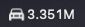

# TeslaMDA



A macOS menu bar app showing Tesla Robotaxi's **Miles Driven Autonomously** from
[tesla.com/robotaxi/safety](https://www.tesla.com/robotaxi/safety).

## How it works

The page's counter isn't live data. Tesla publishes a weekly figure plus a rate, and the page's
JavaScript extrapolates:

```js
const robotaxiMilesStart = 3112541;                                          // as of 10/18/2026 23:59:59 CT
const robotaxiStartEpochTime = new Date('2026-10-19T04:59:59Z').getTime();
const robotaxiMilesPerMillisecond = 0.0009221;                               // ≈ 79,669 mi/day
// shown = start + (now - startTime) * rate
```

The app reads those three constants once a day and runs the same formula locally, so it
needs no polling. A refresh downloads the page HTML and its first-party scripts, but no video
or images.

- **Fetching:** tesla.com is behind Akamai bot protection, which rejects `curl` (by TLS
  fingerprint) but accepts `URLSession`, the same networking stack Safari uses.
- **Refresh safety:** start, date and rate are replaced together or not at all. If Tesla renames
  the variables, the app keeps the last working formula and shows a warning in the menu.
  It only falls back to the static figure in the HTML when no formula has ever been read.
- **Milestones:** small confetti bursts from the menu bar item each time a new million
  (4M, 5M, …) is passed while the app is running. The Settings toggle controls it (macOS Reduce Motion is not consulted). Millions passed while the app was off or the
  Mac was asleep are skipped.

## Settings

Number format (`3.35M`, `3.351M`, `3,351,066`), `mi` suffix,
confetti on/off with a preview, and launch at login.

## Build & install

```bash
swift test              # core logic tests (no network)
./scripts/install.sh    # builds, installs to ~/Applications/TeslaMDA.app, launches
```

Requires macOS 14+. Launch at login needs the app installed in `~/Applications`.

## License

MIT
